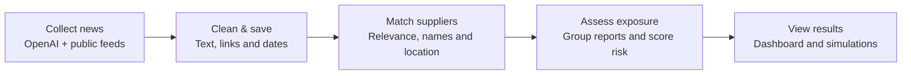

# Silicon Watch

Semiconductor supply-chain monitoring with Python, FastAPI, React, SQL Server and the OpenAI API.

## Problem

A disruption at one supplier can leave several chip components without a backup source. News reports rarely explain those dependencies. A procurement team still needs to work out which suppliers are exposed and which components depend on them.

## Approach

Silicon Watch connects recent news to a supplier-component network. It filters unrelated reports, matches supplier names and shows the evidence behind each signal. A disruption simulator lets you remove a supplier and check which components lose coverage.

The project was inspired by [World Monitor](https://github.com/koala73/worldmonitor), particularly its use of news and geographic context in a single dashboard.

## Pipeline



SQL Server stores the articles, matched events and score history. FastAPI serves the results to the React dashboard.

The worker collects news on startup and waits 10 minutes between completed cycles. React refreshes about every 45 seconds. Monitoring continues after the browser closes, provided the worker stays running.

Before a report becomes a signal:

- Text is cleaned and tracking parameters are removed from links. Stable IDs prevent repeated articles from being stored twice.
- Old reports and unrelated announcements are filtered out with a recorded reason.
- Supplier aliases resolve names such as “Taiwan Semiconductor Manufacturing” to TSMC. Geographic matches are tracked separately.
- Negation and uncertainty checks reduce unsupported outage claims. OpenAI summaries remain low-confidence leads with links to their sources.
- Similar reports are grouped so repeated coverage does not keep increasing the score.

[Processing rules and scoring formulas](docs/PIPELINE.md)

## Stack

| Layer                   | Technology                                      |
| ----------------------- | ----------------------------------------------- |
| Collection and analysis | Python, OpenAI Responses API, httpx, feedparser |
| Backend                 | FastAPI                                         |
| Database                | SQL Server, pyodbc                              |
| Interface               | React, JavaScript, Vite, CSS                    |
| Map                     | d3-geo, Natural Earth                           |

## Run locally

Requires Windows, Python 3.11+, Node.js 22+, SQL Server Express and ODBC Driver 18.

```powershell
Copy-Item .env.example .env
```

Set the SQL Server connection in `.env`. To enable OpenAI news search, add:

```dotenv
OPENAI_NEWS_ENABLED=true
OPENAI_API_KEY=your_api_key_here
OPENAI_MODEL=gpt-5-mini
INGESTION_POLL_SECONDS=600
```

OpenAI searches incur API charges. Keep the key in the backend environment; `.env` is excluded from Git.

```powershell
.\setup-local.ps1
.\start-local.ps1
```

Open [the dashboard](http://127.0.0.1:5173) or [API documentation](http://127.0.0.1:8000/docs). Stop the application with `.\stop-local.ps1`.

[Installation and troubleshooting](docs/SETUP.md)

## Source layout

| Path                                        | Purpose                                            |
| ------------------------------------------- | -------------------------------------------------- |
| `backend/openai_news.py`                    | Web search and cited-result validation             |
| `backend/feeds.py`                          | Feed retrieval and article normalization           |
| `backend/processing.py`                     | Relevance filtering, supplier matching and scoring |
| `backend/worker.py`                         | Scheduled collection and processing                |
| `backend/repository.py`                     | SQL persistence                                    |
| `backend/main.py`                           | API endpoints                                      |
| `backend/schema.sql`, `backend/migrations/` | Database schema                                    |
| `src/`                                      | Dashboard and interactive simulations              |
| `scripts/generate-seed.mjs`                 | Reproducible sample network                        |

## Data and limitations

The sample network contains 48 suppliers, 303 relationships, 32 components and 54 scenarios. Its sourcing relationships and locations are illustrative. Replace them with validated records before using the results for procurement decisions.

Live inputs come from configured news feeds, USGS, Federal Register BIS documents and optional OpenAI web search. Search coverage is incomplete; a quiet dashboard does not establish that a supplier is safe. Scores rank potential exposure and are not outage probabilities. Simulations measure component coverage, without modelling inventory or production capacity.

The OpenAI adapter has automated response-validation tests. Live retrieval quality still needs evaluation with a configured API key. The application binds to localhost; a shared deployment needs authentication and service monitoring.

[Tests and development](docs/VALIDATION.md) · [Attribution](docs/ATTRIBUTION.md)
