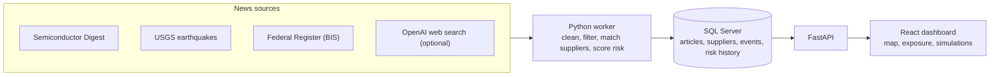

# Silicon Watch

A dashboard that watches the news for semiconductor supply-chain disruptions and shows which suppliers and chip components could be affected.

Built with Python, FastAPI, React, SQL Server and the OpenAI API.

## The problem

Chips depend on a long chain of suppliers. When one of them is hit by an earthquake, a factory fire or a new export rule, the news tells you what happened, but not what it means for you. Someone still has to work out:

- Which of our suppliers are involved?
- Which components do they make for us?
- Do we have another source for those components?

Doing that by hand, across many news sources, is slow and easy to get wrong.

## The solution

Silicon Watch does that work automatically. It:

1. **Reads the news** from trusted sources every few minutes.
2. **Throws out the noise**, keeping only reports about real disruptions.
3. **Links each report to a supplier**, so "Taiwan Semiconductor Manufacturing" is recognised as TSMC.
4. **Scores the risk** based on how serious, recent and reliable the report is.
5. **Shows the impact** on a map and a supplier–component network, with a link back to every source.

A built-in simulator lets you remove a supplier and see which components are left with fewer backups, or none at all.

The idea was inspired by [World Monitor](https://github.com/koala73/worldmonitor), which combines news and maps in a single dashboard.

## How it works



- The **worker** runs in the background. It collects news on startup, then every 10 minutes.
- Every article is cleaned and stored once, even if it shows up again later.
- Each kept report is matched to suppliers by name, or by distance for earthquakes.
- Similar reports are grouped, so the same story repeated by ten outlets doesn't count ten times.
- The **dashboard** refreshes about every 45 seconds. Monitoring keeps running after you close the browser.
- OpenAI results must cite a real, recent link, and are always treated as low-confidence leads.

Full details on the filtering rules and scoring formulas are in [docs/PIPELINE.md](docs/PIPELINE.md).

## Tech stack

| Layer                   | Technology                                      |
| ----------------------- | ----------------------------------------------- |
| Collection and analysis | Python, OpenAI Responses API, httpx, feedparser |
| API                     | FastAPI                                         |
| Database                | SQL Server, pyodbc                              |
| Dashboard               | React, Vite, JavaScript, CSS                    |
| Map                     | d3-geo, Natural Earth                           |

## Run it locally

You'll need Windows, Python 3.11+, Node.js 22+, SQL Server Express and ODBC Driver 18.

1. Copy the example settings file:

   ```powershell
   Copy-Item .env.example .env
   ```

2. Set your SQL Server connection in `.env`. To turn on OpenAI news search (optional, and it costs money per search), also add:

   ```dotenv
   OPENAI_NEWS_ENABLED=true
   OPENAI_API_KEY=your_api_key_here
   OPENAI_MODEL=gpt-5-mini
   ```

3. Install and start:

   ```powershell
   .\setup-local.ps1
   .\start-local.ps1
   ```

4. Open [the dashboard](http://127.0.0.1:5173) or [the API docs](http://127.0.0.1:8000/docs). Stop everything with `.\stop-local.ps1`.

Having trouble? See [docs/SETUP.md](docs/SETUP.md).

## Project layout

| Path                                        | What it does                             |
| ------------------------------------------- | ---------------------------------------- |
| `backend/feeds.py`                          | Fetches and cleans news feeds            |
| `backend/openai_news.py`                    | OpenAI web search and citation checks    |
| `backend/processing.py`                     | Filtering, supplier matching and scoring |
| `backend/worker.py`                         | Runs collection on a schedule            |
| `backend/repository.py`                     | Reads and writes SQL Server              |
| `backend/main.py`                           | API endpoints                            |
| `backend/schema.sql`, `backend/migrations/` | Database schema                          |
| `src/`                                      | React dashboard and simulator            |
| `scripts/generate-seed.mjs`                 | Builds the sample supplier network       |

## Limitations

- **The supplier network is sample data.** It has 48 suppliers, 32 components and 303 links between them, but the relationships and locations are illustrative. Swap in real data before making buying decisions with it.
- **No news doesn't mean no risk.** The sources don't cover everything, so a quiet dashboard doesn't prove a supplier is safe.
- **Scores rank risk, they don't predict it.** A high score means "look at this first", not "this will fail".
- **Simulations only count backup suppliers.** They don't model inventory, production capacity or recovery time.
- **Built for one machine.** It only listens on localhost. Sharing it would need login and monitoring added.

More: [Testing](docs/VALIDATION.md) · [Attribution](docs/ATTRIBUTION.md)
