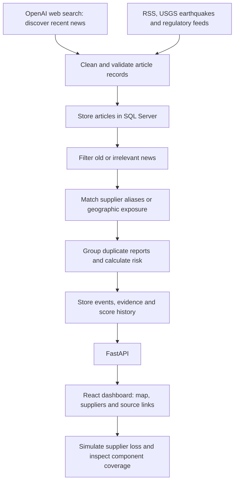

# Silicon Watch
### Semiconductor supply-chain risk monitoring

**Find the news that matters. See which suppliers may be exposed. Understand which components depend on them.**

## The problem

A chip depends on many suppliers. A factory shutdown, export restriction or earthquake can put part of that supply chain at risk. Reading headlines alone does not tell a procurement team which suppliers to investigate or which components have no backup source.

## The solution

Silicon Watch connects current news to a supplier-component network. It collects reports, removes noise, matches relevant suppliers and shows potential exposure in a dashboard. You can then simulate losing a supplier to see which components lose coverage.

The project was inspired by **[World Monitor](https://github.com/koala73/worldmonitor)** and its approach to bringing news and geographic context into one view. Silicon Watch applies that idea to semiconductor sourcing. It is an independent project, not an official World Monitor product.

## The whole pipeline



1. **Collect:** A background Python worker searches for news and checks external feeds. OpenAI uses actual web search, rather than relying only on a model's stored knowledge.
2. **Clean:** Normalize text and links. Keep publication time separate from retrieval time. Stable article IDs prevent the same report being stored repeatedly.
3. **Filter:** Keep recent semiconductor disruption signals. Ordinary announcements and irrelevant reports remain stored with a filtering reason. OpenAI results must have a cited HTTPS link and a valid recent publication date to enter the pipeline.
4. **Match:** Resolve names such as “Taiwan Semiconductor Manufacturing” to TSMC. Match regional exposure separately from direct supplier mentions. Earthquakes use distance from illustrative supplier locations.
5. **Assess:** Group similar reports and calculate explainable scores. Negated or uncertain language is handled conservatively. AI summaries are treated as low-confidence leads, never automatic confirmation of a supplier outage.
6. **Display:** Show potentially exposed suppliers, linked components and the evidence behind each signal. Simulations temporarily remove suppliers to reveal components with fewer alternatives or no remaining coverage.

## Does it monitor continuously?

**Yes, while the worker is running and OpenAI search is enabled.** It fetches on startup, then waits 10 minutes between completed cycles. The dashboard refreshes about every 45 seconds. Closing the browser does not stop the worker; turning off the computer does.

This is periodic monitoring, not an instant or exhaustive news stream. Each OpenAI cycle can incur model and web-search charges. Search results can repeat; deduplication prevents repeated storage. A failed source is shown in source health while other feeds continue.

## What is real, and what is illustrative?

- **Live inputs:** OpenAI web search when configured, Semiconductor Digest RSS, USGS earthquake data and Federal Register BIS documents.
- **Illustrative network:** 48 suppliers, 303 relationships, 32 components and 54 preset scenarios. Company names are recognizable; the included sourcing relationships and locations are not verified procurement records.
- **Risk scores:** Explainable investigation priorities, not probabilities of shutdown. Regional exposure does not establish factory damage.
- **OpenAI integration:** Implemented with automated mock-response tests. A paid live API run still needs a configured key and validation against real responses.

## Run locally

Windows prerequisites: Python 3.11+, Node.js 22+, SQL Server Express and ODBC Driver 18.

```powershell
Copy-Item .env.example .env
```

Edit `.env` locally. Set your SQL Server connection, then enable OpenAI:

```dotenv
OPENAI_NEWS_ENABLED=true
OPENAI_API_KEY=your_api_key_here
OPENAI_MODEL=gpt-5-mini
INGESTION_POLL_SECONDS=600
```

Never commit `.env` or put the key in a frontend variable.

```powershell
.\setup-local.ps1
.\start-local.ps1
```

Open [the dashboard](http://127.0.0.1:5173) or [API documentation](http://127.0.0.1:8000/docs). Stop with `.\stop-local.ps1`. See [setup details](docs/SETUP.md) for installation options and checks. OpenAI is disabled in the example configuration until explicitly enabled.

## Find your way around the code

| Location | What it does |
|---|---|
| `backend/openai_news.py` | Search the web through OpenAI and validate cited results |
| `backend/feeds.py` | Retrieve and normalize source records |
| `backend/processing.py` | Filter relevance, match suppliers, cluster reports and score exposure |
| `backend/worker.py` | Repeat collection and processing in the background |
| `backend/repository.py` | Persist evidence and histories in SQL Server |
| `backend/schema.sql`, `backend/migrations/` | Database structure |
| `backend/main.py` | FastAPI endpoints |
| `src/` | React dashboard and interactive simulations |
| `backend/seed/network.json` | Illustrative supplier network |

[Pipeline details and scoring](docs/PIPELINE.md) · [Validation](docs/VALIDATION.md)

## Next steps

Validate the supplier relationships with a traceable dataset, evaluate matching against labeled articles, and test OpenAI retrieval with real API responses. An always-on deployment also needs authentication and service monitoring. The included app is designed for local use.
